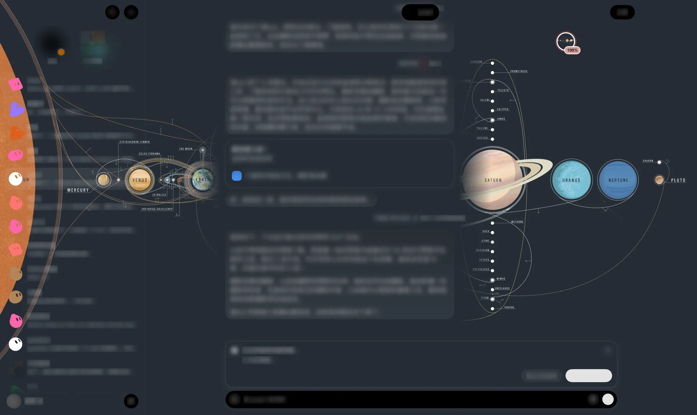
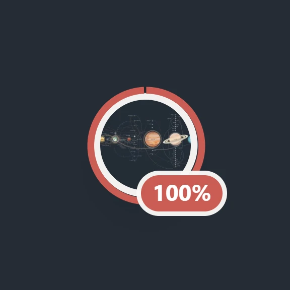
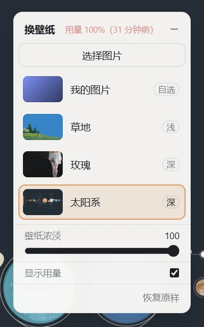

<p align="center">
  
</p>

给 Grok Bot 桌面应用换上自己的壁纸，并把用量一直挂在眼前。不改官方应用，随时恢复原样。

<p align="center">
  
</p>

<sub>真实窗口的截图。聊天内容和侧栏做了虚化。壁纸是内置的「太阳系」。</sub>

<table>
<tr>
<td width="54%" align="center"></td>
<td width="46%" align="center"></td>
</tr>
<tr>
<td align="center"><sub>用量就在窗口角上：一圈环加一个数字，快用完时变红</sub></td>
<td align="center"><sub>换图、调浓淡、开关用量，都在这块面板上点</sub></td>
</tr>
</table>

HUD 是「抬头显示」：一直在眼前、不用伸手去翻的那层信息。它做两件事：

- **换壁纸。** 把你喜欢的那张图设成窗口背景。字压在画上看不清时它会自己处理：深色图配浅色界面，就把界面翻成深色；纯色底的海报，就把回复文字后面那一条擦干净。
- **看用量。** Grok Bot 的用量藏在账户菜单里，每次都要点开才看得到。它把这个数字搬到窗口角上的小圆点上，打开就能看见，快用完时变红。

不是效率工具，也不是官方功能。在 Windows 上验证过；Mac 的代码照文档写了，还没在 Mac 上跑过。

## 它怎么工作

<p align="center">
  
</p>

壁纸不是装进了 Grok Bot，而是每次从外面放进去的一层。工具不碰应用的安装文件，关掉壁纸或者完全退出再打开，窗口就是官方原样。

## 怎么用

需要先装 Node.js 22 或更高版本和 git。先把仓库拿下来：

```bash
git clone https://github.com/dudu2099/grokbot-hud.git
```

```bash
cd grokbot-hud
```

没有别的东西要装，这个工具不依赖任何第三方包。

**交给助手。** 把这句话发给你的 AI 编码助手：

> 帮我安装这个 Grok Bot HUD 项目，然后把我这张图设成背景。步骤看仓库里的 SKILL.md。

**自己动手。** 在仓库目录里执行。用自己的图：

```bash
node scripts/grokbot-wallpaper.mjs apply --image "D:\图片\我喜欢的.jpg"
```

不想找图的话，用内置的：

```bash
node scripts/grokbot-wallpaper.mjs apply meadow
```

| 太阳系 `solar-system` | 草地 `meadow` | 玫瑰 `rose` |
|---|---|---|
|  |  |  |
| 深色 | 浅色 | 深色 |

这三张是第三方作品，随工具带着当示例，版权归原作者，见文末的许可证一节。

图片支持 jpg、png、webp，不超过 4 MB。原图不会被改动或删除，工具只是在自己的数据目录里留一份副本。

第一次用的时候，上面的命令大概率会停下来，告诉你 Grok Bot 的本机调试口还没开。它这时候什么都没关，也什么都没改。你保存好手头的对话，确认可以重启后，在同一条命令后面加上 `--relaunch` 再执行一次。Grok Bot 会关掉再自己打开，壁纸就换上了。

## 以后怎么打开

壁纸不是装进了 Grok Bot，而是每次从外面放进去的。从原来的图标打开 Grok Bot，窗口是官方的原样，没有壁纸。

所以换上之后，建议在桌面放一个专门的图标：

```bash
node scripts/grokbot-wallpaper.mjs launcher on
```

桌面上会多出一个「Grok Bot（带壁纸）」。**想要壁纸就从它打开，不想要就从原来的图标打开。** 原来的图标不会被改动。

双击它时：

- Grok Bot 没开：直接带着壁纸打开。
- Grok Bot 已经带着壁纸开着：只把窗口拿到前面。
- Grok Bot 开着，但是从原来的图标打开的：弹一个对话框问你要不要关掉重开。点「是」才动，点「否」什么都不发生。

不想要这个图标了：

```bash
node scripts/grokbot-wallpaper.mjs launcher off
```

### 想让原来的图标也带壁纸

不想记点哪个图标的话，可以让你平时用的那些 Grok Bot 图标（开始菜单、桌面、任务栏固定）也带着壁纸打开。目前只支持 Windows。

```bash
node scripts/grokbot-wallpaper.mjs always on
```

图标的样子、名字、位置都不变。改之前，工具会把每个图标的原文件存进自己的数据目录。它们还带着一条退路：哪天这个工具的文件夹被删了或挪了，图标会退回去正常打开 Grok Bot，只是没有壁纸。

这样做有两个代价。Grok Bot 只要开着，本机调试口就开着，而不是只在你想要壁纸的时候开。每次打开会慢一两秒，因为要先过一遍工具。

改回原样：

```bash
node scripts/grokbot-wallpaper.mjs always off
```

Grok Bot 每次启动都会把自己的开始菜单图标重写回原样。所以从带壁纸的图标打开之后，后台小助手会盯着这几个图标：发现哪个被写回了原样，就把它重新改成带壁纸打开。它只动 `always on` 改过的那几个，而且只在图标和原样一模一样时才动。被别的程序改成了别的样子的，它不碰。运行过 `always off` 之后，它不再改任何图标。

有一种情况它管不到：你从一个已经被写回原样的图标打开了 Grok Bot，这一次没有壁纸，小助手也没起来。这时从桌面的图标打开一次，或者再运行一次 `always on`。

**删掉或挪走这个工具之前，先运行 `always off`。**

## 窗口里的小面板

换上之后，窗口右上角会出现一个小面板。以后的事都在它上面点，不用再敲命令：

- **选择图片**：换一张自己的图。
- **主题列表**：在内置的三张和「我的图片」之间切换。想固定放几张自己的图，见 [themes/README.md](themes/README.md) 里「只在自己电脑上用的主题」。
- **壁纸浓淡**：一根滑条。往浓了拖，画面更鲜亮；往淡了拖，字更清楚。每张图合适的位置不一样，自己拖到顺眼为止。
- **显示用量**：一个开关，默认开着。见下一节。
- **恢复原样**：去掉壁纸。

面板可以拖到别处，也可以收成一个小圆点。

## 面板上的用量

Grok Bot 的用量藏在左下角的账户菜单里，每次都要点开才看得到。这个工具把它搬到面板上：面板收成小圆点时，圆点外面有一圈进度环，右下角挂着一个写着「98%」的小徽标；展开时，标题旁边写着「用量 98%」。到 80% 环变黄，到 95% 变红。

它是这样拿到数字的：后台小助手隔十分钟左右，替你点开一次那个账户菜单，读「百分之几已用」这一个数，马上关上。点开的那一下菜单是透明的，你看不到它闪。你自己点开账户菜单时，它也会顺手把数字记下来。

几件事请知道：

- **这是工具里唯一一处读页面文字的地方**，也是唯一一处只认 Grok Bot 某个具体菜单的地方。它只读那一个数，不读菜单里别的内容。它不调用 Grok Bot 的用量接口，不看网络请求，数字只留在本机。
- **它不会打断你。** 你几秒内按过键、最近 20 秒动过鼠标或键盘、已经有一个菜单开着、或者账户按钮被弹窗之类的东西盖住时，它都不读，等下一轮。只有刚打开窗口的那一次不等这 20 秒，为的是让数字尽快出来。读完之后，输入框的焦点和光标位置会还回去。
- **窗口被盖住或最小化时它不读。** 那时没人看得到数字。窗口回到眼前后，半分钟左右它会补读一次。
- **官方改了那个菜单，它就读不到了。** 读不到时环和数字不显示，别的功能不受影响。超过半小时没读到新数字，环会变淡。
- **不想要就关掉。** 面板里把「显示用量」关上，或者运行 `usage off`。关掉之后它不再点、不再读。

## 字看不清怎么办

先拖「壁纸浓淡」滑条，往淡的方向。

深色的图配浅色模式的 Grok Bot，本来是最容易糊的一种搭配：深色的字压在深色的画面上。工具会自己处理这种情况。它量出图是深的、应用是浅的，就把整个界面的明暗翻过来，字变浅、面板变深，看起来像 Grok Bot 自己的深色模式。反过来，浅色的图配深色模式的应用，也会翻成浅色。换回同一边的图，或者恢复原样，界面就变回去。

翻过来之后有两处和原来不一样：黑白的头像会反色，阴影会变成一圈亮边。应用里的照片和视频会被翻回去，看着和原来一样。

底色是一整片纯色的图（海报、图表那一类），画的东西常常正好落在聊天文字后面。这种图工具会自己处理：它量出图的底色，在回复文字后面铺一条同色的带子，两边渐渐淡掉。看起来像原图在那里本来就留了空，带子外面的画面不动。带子跟着聊天栏走，拉窗口、收侧栏都对得上。它只量页面上各块的位置，不读文字。底色不是纯色的图（照片、风景）没有这条带子。

选图的小经验：画面主体靠右、左边和中间干净的图最好用，因为聊天文字落在中间那一栏。图里最好不要有字。

## 恢复原样

```bash
node scripts/grokbot-wallpaper.mjs restore
```

壁纸和面板一起消失，界面回到官方的样子，不会重启应用。完全退出 Grok Bot 再打开，效果也会消失。

## 它会在你电脑上留下什么

这一节请看完再用。

- **桌面上一个图标，如果你运行了 `launcher on`。** 从它打开时会带起一个后台小助手，Grok Bot 关掉半分钟后它自己退出，不常驻。
- **一个登录自启项和一个后台小助手。** 第一次套用成功后，工具会在当前用户的启动项里加一条，并在后台留一个小进程。它的作用是：你刷新页面或开新窗口时，壁纸和面板自己回来。它不联网。不想要的话，套用时加 `--no-daemon`，那样壁纸在刷新后会掉，面板也不会出现。
- **被改过的原有图标，如果你运行了 `always on`。** 原文件的备份在数据目录里，`always off` 会逐个写回并核对。
- **一个数据目录。** Windows 在 `%APPDATA%\grokbot-wallpaper\`，Mac 在 `~/Library/Application Support/grokbot-wallpaper/`。里面是上次用的主题、面板位置、滑条的值、最近一次读到的用量数字，和你那张图的副本。

`restore` 只去掉窗口里的壁纸和面板，上面这几样它都不动。要把后台小助手和登录自启一起去掉：

```bash
node scripts/grokbot-wallpaper.mjs autostart off
```

数据目录可以直接手动删除。

### 彻底卸载

按这个顺序做，做完你的电脑上就没有它的东西了：

1. `always off`：把改过的原有图标恢复原样。没运行过 `always on` 可以跳过。
2. `launcher off`：拿掉桌面上的「Grok Bot（带壁纸）」图标。
3. `autostart off`：卸掉登录自启，停掉后台小助手。
4. 完全退出 Grok Bot 再打开，窗口回到官方原样，调试口也关了。
5. 删掉数据目录，再删掉这个仓库的文件夹。

第 1 步一定要在删文件夹之前做。顺序反了的话，图标会指向一个不存在的脚本，这时它们会走退路正常打开 Grok Bot，但图标本身还是改过的样子。

## 用之前要知道的

- **只支持官方 Grok Bot 桌面应用。** 不支持 grok.com 网页，不支持手机端，不支持第三方套壳。
- **这是非官方的本机覆盖层。** 它不修改 Grok Bot 的安装文件、`app.asar` 和签名。官方更新界面后，它可能出现没处理干净的实心色块，那时先 `restore`。
- **它需要打开一个本机调试口。** Grok Bot 要带着 `127.0.0.1:19222` 的调试口启动，工具才能把壁纸放进去。后台小助手另外占用 `127.0.0.1:19223`。两个口都只绑在本机，外面的机器连不上。但调试口开着的时候，你这台电脑上的其他程序也能控制 Grok Bot 的窗口。介意这一点就不要用，也不要做端口转发。
- **它不读你的聊天。** 工具读窗口里各个区域的大小和背景色，用来决定哪块该变透明。读文字的只有一处：「显示用量」开着时，它读账户菜单里「百分之几已用」那一个数，关掉这个开关就连这一处也不读。对话内容、Cookie、登录凭据都不碰，也不联网。你通过面板选的图片只留在本机。
- **从原来的图标打开 Grok Bot 时没有壁纸。** 只有带调试口启动的那次才有，所以才需要上面说的「Grok Bot（带壁纸）」图标。从它打开的那段时间里调试口是开着的，从原来的图标打开时是关着的。

## 命令一览

所有命令都以 `node scripts/grokbot-wallpaper.mjs` 开头。

| 命令 | 做什么 |
|---|---|
| `help` | 打印用法 |
| `status` | 打印当前状态：应用在不在跑、装在哪、调试口开没开、后台小助手和登录自启在不在、上次用的主题 |
| `list` | 列出内置主题 |
| `apply <主题 id>` | 套用内置主题 |
| `apply --image <图片路径>` | 套用自己的图 |
| `restore` | 去掉壁纸和面板，不重启，不卸自启 |
| `launcher on` / `off` | 在桌面放上或拿掉「Grok Bot（带壁纸）」图标 |
| `always on` / `off` | 让原有的 Grok Bot 图标也带壁纸打开，或把它们改回原样。只支持 Windows |
| `launch` | 那个图标实际运行的命令。带着壁纸打开 Grok Bot，需要告诉你的事用对话框说 |
| `usage on` / `off` | 打开或关掉面板上的用量显示。默认开着 |
| `autostart on` / `off` | 装上或卸掉登录自启。`off` 还会停掉后台小助手 |
| `watch` | 在当前终端里前台运行那个小助手，调试用。平时不用手动敲，套用成功后会自己在后台起来 |
| `panel` | 只启动本机面板服务，调试用 |

`apply` 可以加的参数：

| 参数 | 作用 |
|---|---|
| `--relaunch` | 你已经同意重启时用。会关掉并重新打开 Grok Bot |
| `--strength <0-100>` | 壁纸浓淡，和面板里的滑条是同一个值 |
| `--no-daemon` | 不装登录自启，不起后台小助手 |

`apply` 的退出码：

| 退出码 | 意思 |
|---|---|
| 0 | 换上了 |
| 1 | 出错了，看它打印的那句话 |
| 2 | 调试口没开，又没加 `--relaunch`。应用没被动过 |
| 3 | 壁纸放进去了，但没找到可以变透明的面板，你多半看不到它。通常是官方改了界面 |
| 4 | 调试口上应答的不是 Grok Bot，是别的程序。什么都没改 |

加了 `--relaunch` 时，工具会一步一步告诉你它在做什么：先请 Grok Bot 正常退出；过了 3 秒还没退，会提示它可能缩到了托盘里；最多等 15 秒，还不退出就强制结束它，这时没保存的输入可能会丢；然后带调试口重新打开，等它的窗口出来再换壁纸。重新打开失败时它会明说，并请你手动打开。

两个环境变量，一般用不到：

| 变量 | 作用 |
|---|---|
| `GROKBOT_APP_PATH` | 工具找不到你的 Grok Bot 时，用它指明可执行文件的完整路径 |
| `GROKBOT_DEBUG` | 设成 `1`，出错时打印详细信息，方便报问题 |

## 哪些验证过，哪些没有

| 项目 | 状态 |
|---|---|
| Windows 上找到应用、带调试口启动、套主题、换主题、恢复 | 在一台 Windows 11 真机上跑通 |
| 悬浮面板、自己选图片（命令行和面板上选）、浓淡滑条 | 在同一台真机上跑通 |
| 图和应用深浅相反时把界面翻过来 | 浅色模式的应用配深色图跑通。**深色模式的应用配浅色图没跑过** |
| 纯色底的图把回复文字后面擦干净 | 在同一台真机上跑通。**拉窗口、收侧栏之后跟不跟得上没专门试** |
| 桌面图标「Grok Bot（带壁纸）」 | 应用开着时弹确认框、点「是」后带壁纸重开，跑通。**点「否」和放着不点没在真机上走过** |
| `always on`：原有图标也带壁纸 | 跑通，包括 Grok Bot 把开始菜单图标写回原样后小助手再改回来。**`always off` 只在自测的临时文件夹里验过** |
| 刷新页面后壁纸自己回来、登录自启 | 只在自测用的替身页面和临时文件夹里验过，**没在真机上跑过** |
| 面板上显示用量 | 在同一台真机上读到了数字，读完页面上没有留下菜单和临时样式。**正在打字时不打断这一条，只在自测用的替身页面上验过** |
| macOS 全部 | 代码照文档写了，**没有在 Mac 上跑过** |
| 商店版（MSIX）安装的 Grok Bot | 没测过，启动参数可能被丢掉 |

Windows 上如果工具找不到你的 Grok Bot，在 PowerShell 里跑下面这条，把结果贴进 issue：

```powershell
Get-Process | Where-Object { $_.Path -match 'Grok' } | Select-Object Id, ProcessName, Path | Format-List
```

## 致谢

做法参考了 [KinGao294/grokbot-wallpaper](https://github.com/KinGao294/grokbot-wallpaper) 的思路：通过本机调试口往页面里放一层壁纸，而不是去改应用文件。那个仓库没有附许可证，所以本项目的代码是照着这个思路独立重写的，没有复制它的源码。

给 AI 助手看的详细步骤在 [SKILL.md](SKILL.md)。怎么加新的内置主题看 [themes/README.md](themes/README.md)。

## 许可证

代码按 [MIT](LICENSE) 提供。

`themes/` 里的三张内置壁纸不在 MIT 的范围内。它们是第三方作品，版权归各自的原作者，这里只作为壁纸示例随工具带着，来源说明在 [themes/README.md](themes/README.md)。原作者如果希望署名、换一个版本或者移除，提一个 issue，会马上处理。你要把这个工具再分发出去时，请换成你有权使用的图。
